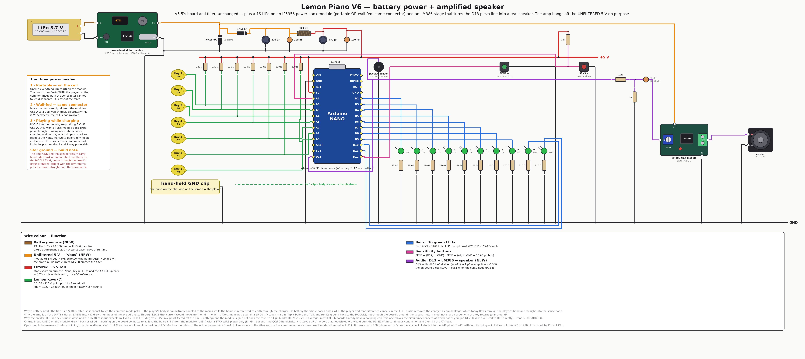
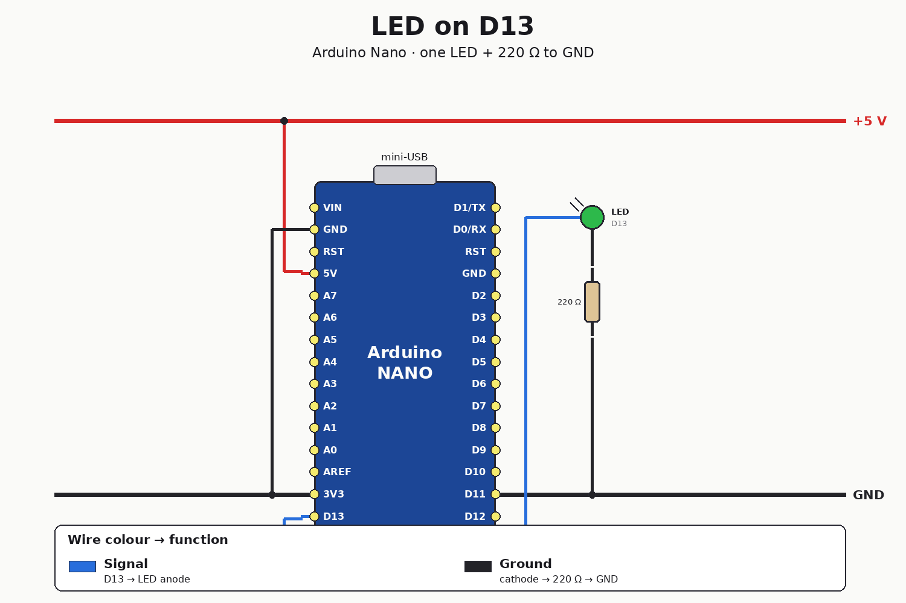
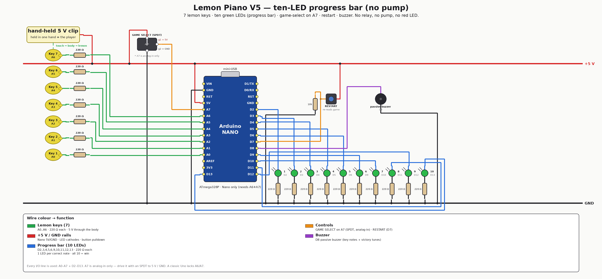

<div align="center">


# eda-wirewright

**Describe *what connects to what* — wirewright figures out *how to draw it*.**

A declarative schematic / wiring-diagram engine with an automatic orthogonal
router and a geometric DRC. Feed it a JSON contract, get back a clean,
CAD-looking PNG — or a structured list of everything that's wrong with your circuit.

[](https://github.com/yupipi93/eda-wirewright/actions/workflows/ci.yml)
[](pyproject.toml)
[](LICENSE)
[](https://wirewright.scv.multitecua.com)
[](#for-ai-models)

[Quickstart](#quickstart) · [Live API](#the-hosted-api) · [For AI models](#for-ai-models) · [The DRC guarantee](#the-drc-guarantee) · [How it works](#how-it-works)



*A real project diagram — LiPo battery → power-bank module → pi filter → Arduino Nano → LED bar → amp → speaker.
Auto-routed and DRC-validated by wirewright from a declarative contract. **Never hand-drawn.***

</div>

---

## Why

Hand-placing wire coordinates always reproduces the same faults: wires over
resistors, confusing crossings, wires too close, pins left visually
unconnected. wirewright kills all of them **structurally**:

- 🚧 **Component bodies are routing obstacles** — a wire physically cannot cross one.
- 📏 **Spacing is a hard rule** — parallel wires of different nets keep their distance.
- 🔌 **Every port in a net is checked** for a real wire endpoint — no floating pins.
- 🧪 **Every diagram is DRC-validated before it is saved** — if it would have a fault, it **doesn't build**.

```
                 wirewright render circuit.json -o circuit.png
   contract  ──────────────────────────────────────────────────►  clean PNG
 (components,        grid A* auto-router  +  DRC (raises on faults)
  ports, nets)
```

The same engine renders a one-LED blinky or a 55-net Arduino game:

| From a 24-line JSON contract… | …to a 55-net rat's nest, still zero DRC violations |
|---|---|
|  |  |
| `examples/json/led_blink.json` | `examples/lemon_piano.py` — 36 / 42 / 55 nets |

Built to be driven by humans *and* by AI models: alongside the Python API there
is a declarative **JSON contract format**, a **CLI**, an **MCP server**, and a
**hosted HTTP API** so an agent (e.g. Claude) can call it as a tool.

> [!TIP]
> **☁️ Live API:** **`https://wirewright.scv.multitecua.com`** — `POST` a contract,
> get a PNG. Public, no auth, agent-ready. Open it in a browser for the landing page.

## Install

```bash
pip install .            # from a clone
# or, for development:
pip install -e '.[dev,mcp]'
```

Rendering needs the **DejaVu** fonts (`fonts-dejavu-core` on Debian/Ubuntu; the
Docker image bundles them). Runtime dependency: **Pillow only**.

## Quickstart

### 1 · Declarative JSON + CLI (recommended, and what AI models use)

```bash
wirewright render   examples/json/led_blink.json -o led.png
wirewright validate examples/json/led_blink.json --json     # DRC only, machine-readable
wirewright components                                        # list component types + ports
```

A minimal contract, and what it renders to:

```json
{
  "canvas": {"w": 1500, "h": 1000, "title": "LED on D13"},
  "rails": [
    {"name": "5V",  "y": 200, "x0": 90, "x1": 1400, "color": "red",   "label": "+5 V"},
    {"name": "GND", "y": 820, "x0": 90, "x1": 1400, "color": "black", "label": "GND"}
  ],
  "components": [
    {"id": "U1", "type": "arduino_nano", "x": 520, "y": 300},
    {"id": "D1", "type": "led",      "x": 980, "y": 360, "args": {"color": "green", "label": "LED", "sub": "D13", "anode": "W"}},
    {"id": "R1", "type": "resistor", "x": 980, "y": 500, "args": {"orient": "V", "label": "220 Ω"}}
  ],
  "nets": [
    {"name": "d13",  "color": "led",   "nodes": [["port","U1","D13"], ["port","D1","anode"]]},
    {"name": "cath", "color": "gnd",   "nodes": [["port","D1","cathode"], ["port","R1","a"]]},
    {"name": "gnd",  "color": "gnd",   "nodes": [["port","R1","b"], ["rail","GND"]]},
    {"name": "pwr",  "color": "power", "nodes": [["port","U1","5V"], ["rail","5V"]]}
  ]
}
```

<div align="center">

</div>

Full format: **[docs/contract-format.md](docs/contract-format.md)** · JSON Schema:
**[schema/schematic.schema.json](schema/schematic.schema.json)**.

### 2 · Python API

```python
from wirewright import Schematic, lib, P, R, Rail, build, save, C

s = Schematic(1500, 1000, title="LED on D13")
s.add_rail(Rail("5V",  y=200, x0=90, x1=1400, color=C["v5"],  label="+5 V"))
s.add_rail(Rail("GND", y=820, x0=90, x1=1400, color=C["gnd"], label="GND"))
s.add(lib.arduino_nano("U1", 520, 300))
s.add(lib.led("D1", 980, 360, C["led"], "LED", "D13", anode="W"))
s.add(lib.resistor("R1", 980, 500, orient="V", label="220 Ω"))
s.connect("d13",  C["led"], P("U1","D13"), P("D1","anode"))
s.connect("cath", C["gnd"], P("D1","cathode"), P("R1","a"))
s.connect("gnd",  C["gnd"], P("R1","b"), R("GND"))
s.connect("pwr",  C["v5"],  P("U1","5V"), R("5V"))

build(s)                 # routes + DRC (raises DRCError on any violation)
save(s, "led.png")
```

Run the bundled examples: `python examples/lemon_piano.py` (three real Arduino
wiring diagrams, 36 / 42 / 55 nets each).

### 3 · Docker

```bash
docker build -t wirewright .
docker run --rm -v "$PWD":/work wirewright render /work/circuit.json -o /work/circuit.png
docker run --rm wirewright components
```

### 4 · The hosted API

`POST` a contract, get a PNG back. Runs on Cloud Run at
**`https://wirewright.scv.multitecua.com`** (public, no auth — call it from
anywhere, including agents):

```bash
# schematic in → PNG out
curl -X POST https://wirewright.scv.multitecua.com/render \
     -H 'Content-Type: application/json' \
     -d @circuit.json -o circuit.png

# DRC only (structured JSON), or the image as base64 for agents:
curl -X POST https://wirewright.scv.multitecua.com/validate -d @circuit.json -H 'Content-Type: application/json'
curl -X POST 'https://wirewright.scv.multitecua.com/render?format=json' -d @circuit.json -H 'Content-Type: application/json'
```

| endpoint | does |
|---|---|
| `GET /` | landing page in a browser (HTML) · JSON for API clients |
| `GET /health` | liveness |
| `GET /components` | component catalogue (types, ports, params) |
| `GET /openapi.json` | OpenAPI 3 spec (agents self-configure from this) |
| `POST /validate` | route + DRC only → JSON (`ok` / `drc_failed` / `invalid_contract`) |
| `POST /render` | route + DRC + render → `image/png` (or JSON+base64 with `?format=json`) |

Errors are structured JSON with the right status (`400` bad contract, `422` DRC
failed with `violations[]`), so an agent can fix and retry. Run it yourself:
`docker build -f deploy/Dockerfile -t wirewright-api . && docker run -p 8080:8080 wirewright-api`.

## For AI models

wirewright is designed so an LLM can produce diagrams reliably:

- **Emit JSON, get a picture.** The contract is a plain JSON object; no Python
  needed. See [AGENTS.md](AGENTS.md) for the exact recipe.
- **Self-describing components.** `wirewright components --json` (or the
  `list_components` MCP tool) returns every type, its ports and parameters, so
  the model never has to guess names.
- **Actionable errors.** A bad contract fails with a specific, fixable message
  (`"D1 has no port 'anodX' (has: anode, cathode)"`, `"unknown type
  'arduino_nan' — did you mean 'arduino_nano'?"`). DRC failures return a
  structured list of violations. The model can correct and retry.
- **MCP server.** `wirewright-mcp` exposes `list_components`, `validate_schematic`
  and `render_schematic` (returns the PNG as base64). Add it to an MCP client:

  ```json
  { "mcpServers": { "wirewright": { "command": "wirewright-mcp" } } }
  ```

## The DRC guarantee

`build()` raises `DRCError` (never writes a file) on any of:

| check | rule |
|---|---|
| `wire-over-component` | no wire passes through a component body |
| `coincident-wires`    | no two different nets drawn on top of each other |
| `unconnected-pin`     | every port named in a net has a wire endpoint on it |
| `wires-too-close`     | parallel different-net wires stay ≥ `min_wire_spacing` apart |

## Component catalogue

20 built-in types, each with typed ports — run `wirewright components` for
ports + parameters:

| family | types |
|---|---|
| boards | `arduino_nano` |
| passives | `resistor` · `capacitor` · `inductor` · `diode` |
| indicators & sound | `led` · `buzzer` · `speaker` · `amp_module` |
| input | `push_button` · `spdt_switch` · `rotary_encoder` · `lemon_key` · `clip_box` |
| power | `battery` · `power_bank_module` · `power_jack` |
| modules & actuators | `relay_module` · `water_pump` · `ultrasonic` |

Plus decorations (`legend`, `deco.panel`, notes, dashed annotation arrows) for
self-explanatory diagrams.

Adding a component is a small factory in
[`src/wirewright/library.py`](src/wirewright/library.py) (a body box + typed
ports + a draw function) — then it works everywhere (Python, JSON, CLI, MCP, HTTP API).

## Configuration (parametrised)

Every knob lives in [`config.py`](src/wirewright/config.py) and can be set in the
JSON `config` block, via CLI flags, or a `Config` object:

| knob | meaning |
|---|---|
| `pitch` | routing-grid resolution (px); smaller = finer, slower |
| `bend_penalty` | cost of a corner; higher = straighter wires |
| `min_wire_spacing` | spacing DRC threshold (px) |
| `body_clearance` | keep-out halo around bodies |
| `label_soft_cost` | how hard wires avoid label text |
| `stub_px` | pin escape-stub length |

```bash
wirewright render circuit.json --pitch 12 --bend 20 --spacing 8
```

## How it works

Everything snaps to a routing grid. Component bodies (plus a clearance halo) are
hard obstacles; each pin gets a mandatory perpendicular **escape stub**. Nets are
routed shortest-span-first with a **grid A\*** whose state is *(cell, incoming
direction)* — a large **bend penalty** yields long straight runs (the CAD look)
and a light **proximity penalty** keeps wires apart (they cross cleanly rather
than detour). Each net commits to the grid before the next routes. Junction dots
are drawn only where ≥3 segments of the *same* net meet. A geometric DRC then
proves the result. Full write-up: [docs/architecture.md](docs/architecture.md).

## Development

```bash
make dev       # editable install + dev/mcp extras
make test      # pytest
make lint      # ruff
make examples  # render every example into examples/out/
make docker    # build the image
```

CI (GitHub Actions) runs lint + tests across Python 3.9–3.12, renders every
example (DRC must pass), and builds the Docker image.

## Related projects

| repo | what |
|---|---|
| [eda-pcb-designer](https://github.com/yupipi93/eda-pcb-designer) | The sibling tool: a deterministic KiCad-9 **PCB** pipeline (placement → autoroute → DRC → gerbers), same engine + hosted-API + agent-protocol pattern |
| [arduino-lemon-piano](https://github.com/yupipi93/arduino-lemon-piano) | The project wirewright was extracted from — every wiring diagram in it is rendered by wirewright |

## Licence

MIT — see [LICENSE](LICENSE).
